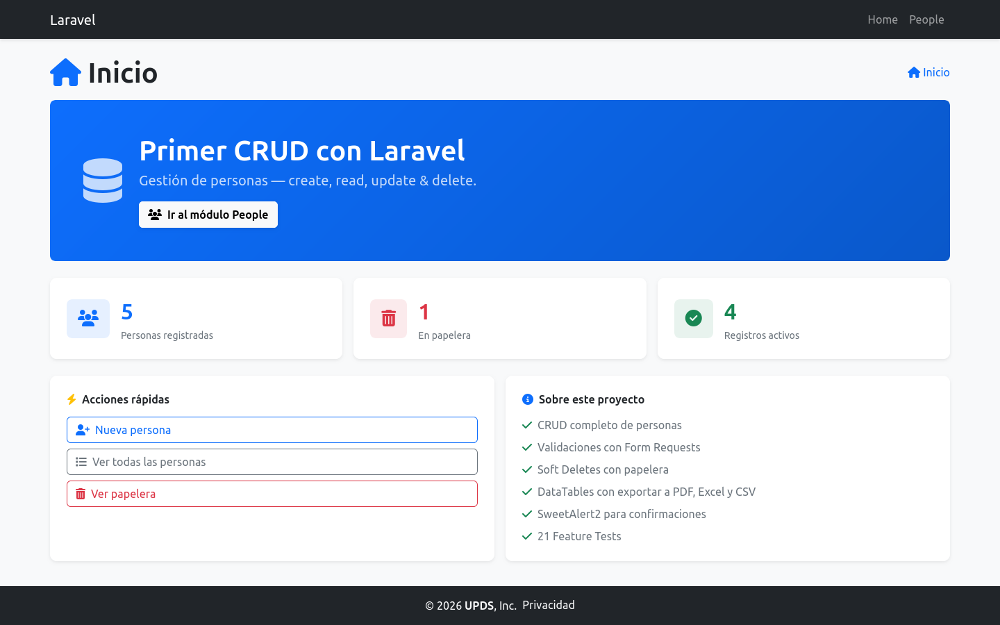
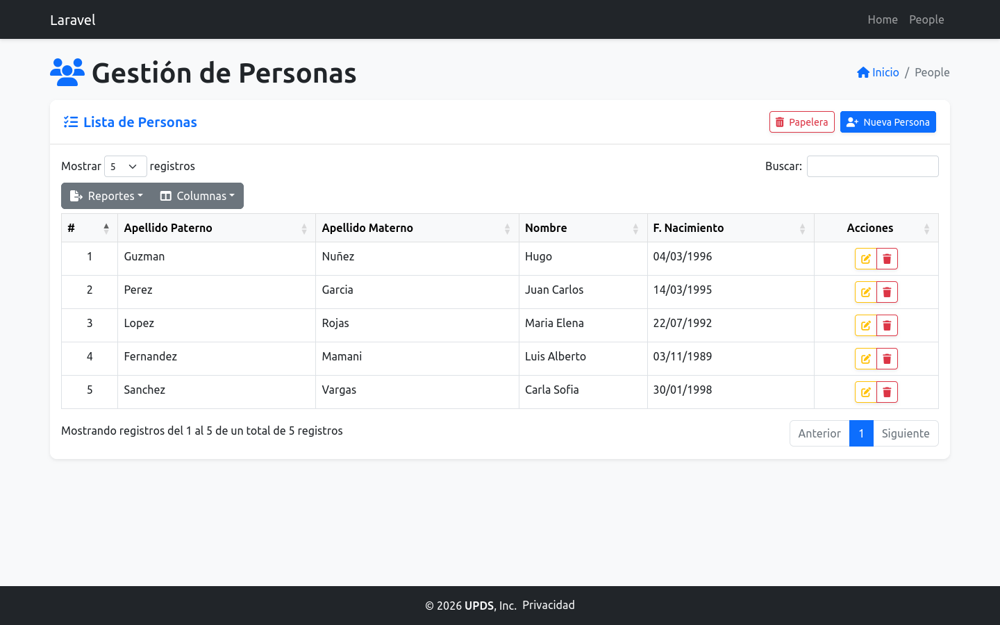
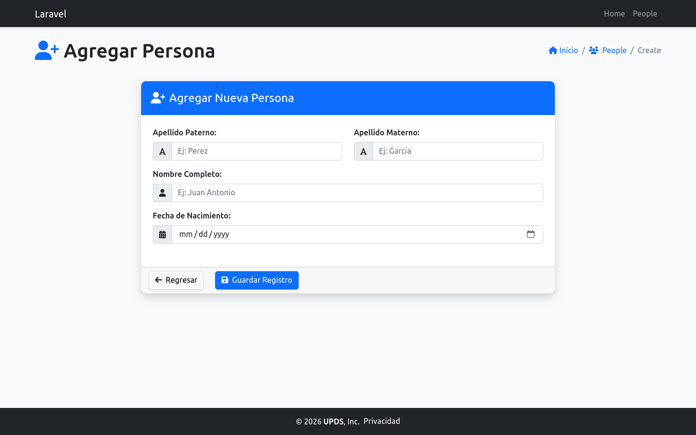
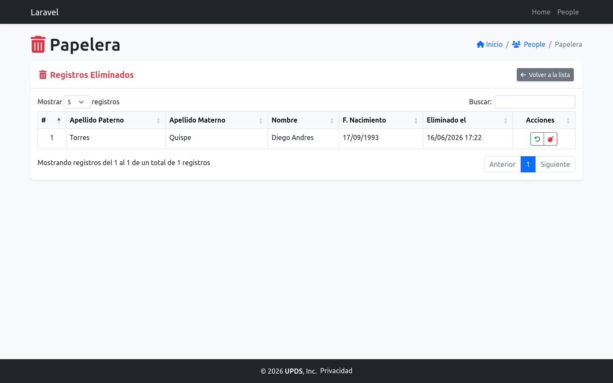
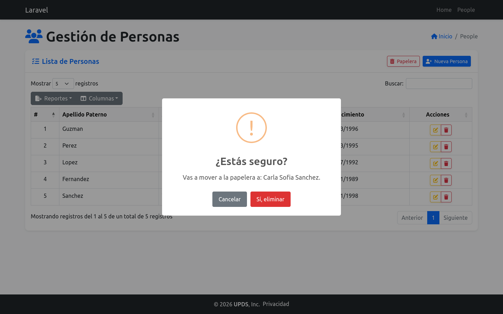

<div align="center">

# Primer CRUD Laravel


Aplicación de práctica desarrollada con **Laravel 10** para gestionar personas mediante operaciones CRUD completas, con papelera de reciclaje, validaciones, exportación de reportes y suite de tests.

</div>

<p align="center">
  <a href="#vista-previa">Vista previa</a> ·
  <a href="#objetivo-del-proyecto">Objetivo</a> ·
  <a href="#tecnologías-utilizadas">Tecnologías</a> ·
  <a href="#estructura-funcional">Rutas</a> ·
  <a href="#instalación-y-ejecución-local">Instalación</a> ·
  <a href="#pruebas">Tests</a>
</p>

---

## Vista previa

<table>
  <tr>
    <td align="center" width="50%">
      <br>
      <sub>Inicio — estadísticas y accesos rápidos</sub>
    </td>
    <td align="center" width="50%">
      <br>
      <sub>Listado de personas (DataTables)</sub>
    </td>
  </tr>
  <tr>
    <td align="center" width="50%">
      <br>
      <sub>Formulario de creación</sub>
    </td>
    <td align="center" width="50%">
      <br>
      <sub>Papelera de reciclaje</sub>
    </td>
  </tr>
  <tr>
    <td align="center" colspan="2">
      <br>
      <sub>Confirmación de acciones con SweetAlert2</sub>
    </td>
  </tr>
</table>

## Objetivo del proyecto

Este repositorio está orientado a aprendizaje y práctica de:

- Arquitectura MVC en Laravel.
- Rutas y controladores para flujos CRUD.
- Form Requests para validación del lado servidor.
- Soft Deletes y papelera de reciclaje.
- Vistas Blade reutilizables con layout compartido.
- Integración de componentes frontend (Bootstrap, DataTables, SweetAlert2).
- Feature Tests con PHPUnit y base de datos en memoria (SQLite).

## Tecnologías utilizadas

| Componente        | Versión / Uso                                   |
| ----------------- | ----------------------------------------------- |
| PHP               | ^8.1                                            |
| Laravel           | ^10.10                                          |
| Base de datos     | MySQL/MariaDB (vía migraciones de Laravel)      |
| Frontend          | Blade + Bootstrap 5.2                           |
| Tabla interactiva | DataTables 1.13 + Buttons 2.3 (CSV, Excel, PDF) |
| Alertas           | SweetAlert2                                     |
| Bundler de assets | Vite                                            |
| Tests             | PHPUnit + SQLite en memoria                     |

## Estructura funcional

- **Home principal:** `/` — estadísticas en tiempo real y acciones rápidas
- **Módulo People (CRUD):** prefijo `/people`

| Método | Ruta                        | Nombre                 | Descripción                     |
| ------ | --------------------------- | ---------------------- | ------------------------------- |
| GET    | `/people`                   | `personas.index`       | Listado de personas activas     |
| GET    | `/people/create`            | `personas.create`      | Formulario de creación          |
| POST   | `/people/store`             | `personas.store`       | Guardar nueva persona           |
| GET    | `/people/edit/{id}`         | `personas.edit`        | Formulario de edición           |
| PUT    | `/people/update/{id}`       | `personas.update`      | Actualizar persona              |
| DELETE | `/people/destroy/{id}`      | `personas.destroy`     | Mover a papelera (soft delete)  |
| GET    | `/people/trash`             | `personas.trash`       | Listado de registros eliminados |
| PUT    | `/people/restore/{id}`      | `personas.restore`     | Restaurar desde papelera        |
| DELETE | `/people/force-delete/{id}` | `personas.forceDelete` | Eliminar permanentemente        |

## Modelo y datos

La entidad principal es `personas`, con los campos:

| Campo              | Tipo      | Descripción            |
| ------------------ | --------- | ---------------------- |
| `nombre`           | string    | Nombre(s)              |
| `paterno`          | string    | Apellido paterno       |
| `materno`          | string    | Apellido materno       |
| `fecha_nacimiento` | date      | Fecha de nacimiento    |
| `deleted_at`       | timestamp | Soft delete (papelera) |

## Validaciones

Gestionadas con Form Requests (`StorePersonaRequest` / `UpdatePersonaRequest`):

- Todos los campos son requeridos.
- Campos de texto con máximo 100 caracteres.
- `fecha_nacimiento` debe ser una fecha válida y anterior a hoy.
- Los formularios muestran errores inline con Bootstrap y conservan los valores ingresados.

## Instalación y ejecución local

1. Clonar el repositorio:
    ```bash
    git clone <URL_DEL_REPOSITORIO>
    cd Primer_CRUD_Laravel
    ```
2. Instalar dependencias:
    ```bash
    composer install
    npm install
    ```
3. Configurar entorno:
    ```bash
    cp .env.example .env
    php artisan key:generate
    ```
4. Configurar conexión a base de datos en `.env`.
5. Ejecutar migraciones:
    ```bash
    php artisan migrate
    ```
6. Poblar datos de ejemplo (opcional):
    ```bash
    php artisan db:seed
    ```
7. Levantar la aplicación:
    ```bash
    php artisan serve
    npm run dev
    ```

## Pruebas

Los tests usan SQLite en memoria y no afectan la base de datos real.

```bash
php artisan test
```

Cobertura actual — **21 tests, 54 assertions**:

| Área           | Casos cubiertos                                                  |
| -------------- | ---------------------------------------------------------------- |
| Index / Create | Respuesta 200, visualización de datos                            |
| Store          | Guardado exitoso, campos requeridos, max 100 chars, fecha futura |
| Edit / Update  | Formulario con datos, actualización, validaciones                |
| Soft Delete    | Mover a papelera, no aparece en index                            |
| Trash          | Listado de eliminados                                            |
| Restore        | Recuperación desde papelera                                      |
| Force Delete   | Eliminación permanente                                           |

## Solución de problemas

**Error 500 al servir el proyecto con Apache/XAMPP (`storage/logs/laravel.log ... Permission denied`).**
El usuario con el que corre Apache (`daemon` en XAMPP/LAMPP sobre Linux) necesita permisos de escritura sobre `storage/` y `bootstrap/cache/`:

```bash
sudo chown -R $USER:daemon storage bootstrap/cache
sudo chmod -R 775 storage bootstrap/cache
```

Esto no aplica al usar `php artisan serve`, ya que corre con el usuario actual de la terminal.

---

<div align="center">

## Licencia

Este proyecto se distribuye bajo la licencia [MIT](./LICENSE).

</div>
